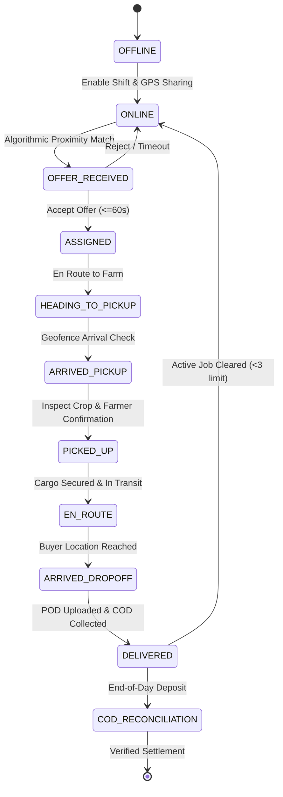

# AgriMarket Direct: Delivery Worker Operations Manual & Standard Operating Procedures (SOP)
**Document Identifier:** AGRI-SOP-DELIVERY-2026-V1.0  
**Target Audience:** Delivery Couriers, Fleet Supervisors, Logistics Operations Managers, Platform Engineers  
**System Reference:** AgriMarket Direct Platform (IEEE Std 1016-2009 / ISO/IEC 42010 Architecture)  
**Effective Date:** November 2026  
**Status:** Official Operational Standard  

---

## 1. Executive Summary & Purpose
The **AgriMarket Direct Delivery Worker Operations Manual** defines the end-to-end responsibilities, technical protocols, quality standards, and standard operating procedures (SOPs) for delivery couriers operating within the AgriMarket Direct ecosystem. 

AgriMarket Direct eliminates exploitative agricultural middlemen by connecting rural Ethiopian smallholder farmers directly to urban commercial buyers (restaurants, grocers, institutional kitchens, and retail consumers). The Delivery Worker (Courier) serves as the indispensable physical bridge in this ecosystem, ensuring that perishable crops move from farm gates and regional aggregation hubs to buyers swiftly, safely, and transparently.

This manual details every phase of courier operations—from onboarding and shift readiness, through dynamic dispatch offer evaluation, farm-gate pickup, temperature and packaging maintenance, delivery drop-off, proof-of-delivery (POD) capture, Cash-on-Delivery (COD) financial reconciliation, to incident management.

---

## 2. Delivery Worker Role & Requirements

### 2.1 Courier Core Role Definition
A Delivery Worker on AgriMarket Direct is an authorized independent transporter or fleet driver who:
1. Receives algorithmic delivery offers based on real-time proximity and vehicle cargo capacity.
2. Navigates to rural or peri-urban farm gates to inspect and collect harvested produce.
3. Transports agricultural goods under sanitary and ventilated conditions.
4. Completes verified drop-offs to buyers using multi-factor digital proof-of-delivery.
5. Collects and reconciles Cash-on-Delivery payments with zero tolerance for financial discrepancies.

### 2.2 Vehicle Classifications & Cargo Capacities
Couriers are assigned jobs matched dynamically to their verified vehicle profile:

| Vehicle Classification | Code | Payload Capacity (kg) | Ideal Agricultural Produce Types | Typical Route Profile |
|:---|:---|:---:|:---|:---|
| **Motorcycle / Two-Wheeler** | `MOTORCYCLE` | 10 – 50 kg | Herbs, spices, strawberries, cherry tomatoes, emergency dairy | Urban express, dense city center, quick parcel dispatch |
| **Three-Wheeler (Bajaj / Tuk-Tuk)** | `BAJAJ` | 50 – 300 kg | Crates of tomatoes, peppers, leafy greens, table eggs | Peri-urban farm corridors, cobblestone neighborhood roads |
| **Light Pickup / Minivan** | `PICKUP` | 300 – 1,200 kg | Sacks of potatoes, onions, cabbage, bulk melons, avocado | Regional feeder roads to urban distribution points |
| **Medium Commercial Truck (Isuzu ELF / FSR)** | `TRUCK_MEDIUM` | 1,200 – 4,500 kg | Teff, wheat, maize, dry grains, bulk tubers, cooperative harvests | Inter-city arterial routes, rural aggregation hub transfers |
| **Refrigerated / Insulated Van** | `REEFER_VAN` | 500 – 2,500 kg | Pasteurized milk, artisanal cheese, poultry, cut flowers, mushrooms | Cold-chain compliant corridors with active temperature logging |

### 2.3 Prerequisites & Verification Standards
To be active on the platform, a delivery courier must fulfill:
- **Identification:** Valid Government Kebele ID or National Fayda Digital ID (expedited biometric tier).
- **Driver Licensing:** Valid Ethiopian Driver's License corresponding to the vehicle category.
- **Vehicle Documentation:** Valid Libre (title/ownership certificate) and annual roadworthiness inspection stamp (*Bolo*).
- **Smartphone Device:** Android 8.0+ or iOS 14+ smartphone with functioning GPS, rear camera for POD photos, and reliable 3G/4G connectivity.
- **Background Clearance:** Clean municipal driving record and criminal background verification conducted by AgriMarket Superadmin team.

---

## 3. Operational Workflow & Step-by-Step SOP

The delivery courier lifecycle is represented by the state machine below:



---

### Step 1: Pre-Shift Preparation & Going Online
1. **Physical Inspection:**
   - Verify fuel levels, tire pressure, brakes, and cargo tie-down straps.
   - Clean the cargo bed or delivery box. No chemical residues, dirt, or foreign odors that could contaminate food produce.
   - Prepare reusable clean plastic crates, breathable gunny sacks, or clean tarpaulins.
2. **Device Readiness:**
   - Ensure smartphone battery is at least 80% charged (carry a 10,000mAh+ power bank).
   - Enable device GPS Location Services (High Accuracy mode).
3. **Application Sign-In & Location Consent:**
   - Open the **AgriMarket Courier Dashboard** (`/dashboard/worker`).
   - Open the **Availability & GPS** tab.
   - Toggle status from `OFFLINE` to `ONLINE`.
   - Grant consent to share live GPS coordinates (`LocationShareWidget`). The system transmits location updates to the backend dispatch engine (`backend/src/services/dispatch.service.ts`).

---

### Step 2: Evaluating & Accepting Delivery Offers
When an order is placed and grouped (pursuant to SDD §3.1 Cart Partitioning), the dispatch engine identifies eligible online couriers within the broadcast radius (default 5 km, expandable to 25 km in rural zones):
1. **Offer Notification:**
   - An alert sounds with a 60-second countdown timer.
   - Review the offer card:
     - **Pickup Location:** Farmer name, Woreda, and approximate distance.
     - **Dropoff Location:** Buyer neighborhood/subcity and total delivery distance.
     - **Cargo Specifications:** Produce type, total weight in kg, crating requirements.
     - **Compensation:** Total guaranteed courier payout (ETB) + any heavy cargo allowance.
     - **Payment Type:** Prepaid Digital (Chapa/Telebirr) or Cash-on-Delivery (COD).
2. **Decision & Concurrency Contract:**
   - **Accept Offer:** Tap **"Accept Delivery"**. The system executes an atomic PostgreSQL transaction that assigns the job exclusively to you and withdraws competing offers.
   - **Reject Offer:** If vehicle capacity is insufficient or current traffic makes the trip impossible, tap **"Decline"** and select a valid reason (e.g., *Exceeds current payload*, *Mechanical maintenance needed*).

> [!IMPORTANT]
> A delivery courier can maintain up to a maximum of **3 active jobs concurrently** (for optimized route batching). Exceeding 3 active jobs blocks new offer broadcasts until current orders are delivered.

---

### Step 3: Farm-Gate Pickup Protocol
1. **Transit to Origin (`HEADING_TO_PICKUP`):**
   - Tap **"Start Navigation"** on the active job card.
   - In accordance with SDD §3.2 (Differential Geolocation Privacy Model), once you accept the job, the farmer's exact high-precision latitude and longitude are unmasked to your navigation app.
   - Proceed directly to the farm pickup point.
2. **Arrival at Farm (`ARRIVED_PICKUP`):**
   - Upon arriving within 100 meters of the farm gate, tap **"Arrived at Farm"**.
   - Contact the farmer via in-app verified calling or messaging if farm gate entrance is gated.
3. **Physical Inspection & Quality Check (HACCP Food Safety Guidelines):**
   - **Packaging Integrity:** Check that crates are not cracked and produce is packed securely.
   - **Freshness & Visual Quality:** Inspect for visible mold, rotting, extreme dehydration, or insect infestation.
   - **Weight & Count Verification:** Compare the quantity on the app (e.g., 50 kg red onions) with the farmer's scale.
   - **Discrepancy Reporting:** If the produce is damaged or significantly underweight before pickup, **do not accept the consignment**. Tap **"Report Incident"** -> **"Crop Defect at Pickup"**.
4. **Handover Confirmation (`PICKED_UP`):**
   - Confirm handover with the farmer.
   - Tap **"Confirm Pickup"** in the app. Status transitions to `PICKED_UP`. The farmer's escrow balance updates accordingly, and the buyer receives a live tracking push notification.

---

### Step 4: Cargo Transit & In-Route Handling
1. **Securing Produce:**
   - Place heavy produce (tubers, squash, cabbage) at the bottom; stack soft items (tomatoes, strawberries, soft fruits) on top in rigid crates.
   - Ensure adequate ventilation during hot midday sun. Cover with a breathable UV-blocking tarpaulin rather than airtight plastic sheeting which traps heat and induces rotting.
2. **En Route Navigation (`EN_ROUTE`):**
   - Tap **"Start Delivery Route"**. Status transitions to `EN_ROUTE`.
   - Maintain steady transit speed. Avoid rough jolting on gravel or unpaved rural roads to prevent bruising fresh produce.
   - The app's background service transmits GPS pings every 30 to 60 seconds, allowing the buyer to track the incoming shipment live.

---

### Step 5: Buyer Drop-Off & Proof of Delivery (POD)
1. **Arrival at Destination (`ARRIVED_DROPOFF`):**
   - Arrive at the buyer's specified address (store, commercial kitchen, or residence).
   - Tap **"Arrived at Destination"**.
2. **Produce Handover:**
   - Unload the crates carefully into the buyer's designated receiving area.
   - Allow the buyer 3 to 5 minutes to inspect the consignment for carton count and freshness.
3. **Multi-Factor Proof-of-Delivery (POD):**
   AgriMarket Direct enforces strict non-repudiation for deliveries. Couriers must complete at least one verified POD method:
   - **Method A: Buyer Delivery OTP (Recommended):** Request the 4-digit secret delivery code displayed on the buyer's AgriMarket app or SMS notification. Enter it into the courier app.
   - **Method B: Geotagged Photo Proof:** Tap **"Take POD Photo"**. Capture a clear photo showing the delivered produce placed at the buyer's premises with the invoice or property entrance clearly visible.
   - **Method C: Recipient Digital Signature:** Have the receiving manager or buyer sign directly on the courier device touch screen.
4. **Completing the Job (`DELIVERED`):**
   - Tap **"Complete Delivery"**. The delivery job status updates to `DELIVERED`.
   - Your delivery fee is credited to your Courier Balance immediately.

---

### Step 6: Cash-on-Delivery (COD) Collection & Daily Reconciliation

When handling orders marked as `CASH_ON_DELIVERY`:
1. **Collection Rule:** You must collect the **exact total invoice amount in cash** prior to handing over custody of the produce. Partial payments or personal promises are strictly prohibited.
2. **Immediate Receipt Issuance:** Tap **"Confirm Cash Collected"** in the app and hand the physical printed receipt or show the digital confirmation screen to the buyer.
3. **Cash Limits & Auto-Lock:**
   - Couriers are permitted a maximum un-reconciled COD cash-in-hand limit of **ETB 15,000**.
   - If accumulated un-deposited COD reaches ETB 15,000, new COD dispatch offers are paused until a reconciliation deposit is completed.
4. **Reconciliation Channels:**
   - **Option 1: Mobile Money Direct Deposit (Telebirr / CBE Birr):** Transfer the collected cash balance to the AgriMarket Direct merchant corporate account (`Telebirr: 0911-XXXXXX` or `CBE: 1000XXXXXXXX`). Enter the bank reference transaction ID in the **"Earnings & COD"** tab and tap **"Submit Reconciliation"**.
   - **Option 2: Regional Hub Cashier Deposit:** Deliver physical banknotes to the designated AgriMarket Regional Aggregation Hub cashier before 6:00 PM. The cashier issues an immediate digital clearance receipt.

---

## 4. Exception Handling & Incident Reporting SOP

When unexpected situations arise in the field, couriers must adhere to standard incident protocols via the **"Support & Incidents"** module:

```
+----------------------------------------------------------------------------------------------------+
|                                    INCIDENT RESPONSE MATRIX                                        |
+--------------------------+----------------------------------------------------+--------------------+
| Incident Type            | Required Action                                    | System Action      |
+--------------------------+----------------------------------------------------+--------------------+
| Vehicle Breakdown / Flat | 1. Move to a safe shoulder away from traffic.      | Dispatch Engine    |
| Tire                     | 2. Report incident: "Mechanical Breakdown".        | automatically      |
|                          | 3. If within 30 min of repair, repair and proceed. | re-routes nearby   |
|                          | 4. If severe, dispatch reallocates a relief van.   | relief courier.    |
+--------------------------+----------------------------------------------------+--------------------+
| Buyer Absent /           | 1. Call buyer phone 3 times over a 10-minute span. | If timer expires,  |
| Unreachable              | 2. Ring doorbell / alert security guard on site.   | system re-routes   |
|                          | 3. If no response after 15 mins, tap "Buyer        | to nearest Hub     |
|                          |    Unreachable".                                   | for return credit. |
+--------------------------+----------------------------------------------------+--------------------+
| Fresh Produce Spoilage / | 1. Take 3 clear photos of the damaged produce.     | Triggers dispute   |
| Buyer Rejection          | 2. Do NOT discard the goods.                       | resolution triage; |
|                          | 3. Tap "Cargo Rejected by Buyer".                  | courier paid       |
|                          | 4. Return goods to Hub or follow admin directive.  | transport fee.     |
+--------------------------+----------------------------------------------------+--------------------+
| Severe Road Closure /    | 1. Do not risk vehicle submergence or accident.    | Recomputes route   |
| Impassable Mud           | 2. Document road block photo and tap "Road Hazard".| or extends job     |
|                          | 3. System calculates alternate gravel bypass.      | delivery deadline. |
+--------------------------+----------------------------------------------------+--------------------+
```

---

## 5. Key Performance Indicators (KPIs) & Quality Benchmarks

To maintain active certified status on the AgriMarket Direct Courier Network, couriers are evaluated across six core performance metrics:

| Key Performance Indicator | Target Benchmark | Warning Threshold | Corrective Action Trigger |
|:---|:---:|:---:|:---|
| **Offer Acceptance Rate (OAR)** | ≥ 80% | < 70% | Temporary reduction in priority dispatch matching |
| **On-Time Farm Pickup Rate** | ≥ 92% | < 85% | Notification and review of scheduled route corridors |
| **On-Time Buyer Delivery Rate** | ≥ 95% | < 90% | Retraining on route navigation and urban traffic planning |
| **Proof-of-Delivery (POD) Compliance** | 100% | < 98% | Compulsory verification before payment release |
| **Customer Satisfaction (CSAT Rating)** | ≥ 4.7 / 5.0 | < 4.2 / 5.0 | Mandatory review with Regional Fleet Manager |
| **COD Settlement Speed** | Within 24 hours | > 24 hours | Account locked until cash balance is fully reconciled |

---

## 6. Courier Compensation & Earning Model

Courier earnings are calculated transparently per completed delivery job:

$$\text{Total Payout} = \text{Base Pickup Fee} + (d_{\text{km}} \times \text{Per-KM Rate}) + \text{Weight Tier Bonus} + \text{Weather / Peak Incentive}$$

- **Base Pickup Fee:** ETB 75 (covers initial arrival and loading time at the farm gate).
- **Distance Allowance ($d_{\text{km}}$):**
  - Urban paved roads: ETB 18 / km.
  - Rural unpaved / feeder roads: ETB 26 / km (compensates for fuel and vehicle wear).
- **Weight Tier Bonus:**
  - 0 – 50 kg: Base.
  - 51 – 200 kg: + ETB 60.
  - 201 – 500 kg: + ETB 150.
  - 500 kg+: + ETB 0.60 per additional kg.
- **On-Time & Zero-Spillage Bonus:** Monthly bonus awarded to couriers achieving > 98% on-time delivery with zero produce damage claims.

---

## 7. Professional Recommendations for System & Operations

Based on agricultural supply chain engineering, rural Ethiopian logistics realities, and the AgriMarket Direct software architecture, the following six strategic recommendations are provided to maximize courier efficiency, reduce food spoilage, and elevate operational profitability:

### 1. Dynamic Multi-Stop Batching & Farm Corridor Clustering
- **Current Situation:** Each child order initiates an independent delivery job. If two farmers in the same woreda (e.g., Lume / Mojo) are fulfilling orders for two restaurants in the Bole subcity, two separate couriers might be dispatched.
- **Recommendation:** Implement algorithmic **Corridor Clustering** in `dispatch.service.ts`. The dispatch engine should group nearby farm pickups occurring within a 45-minute window and assign them to a single medium vehicle (Bajaj or Pickup). This increases the courier’s payout per run by 40–60% while reducing aggregate delivery costs for buyers by 25%.

### 2. Standardized Perishable Crate Exchange & Thermal Tarpaulins
- **Current Situation:** Farmers and couriers frequently utilize non-standard gunny sacks, causing fragile crops (tomatoes, ripe papayas, strawberries) to suffer compression bruising and heat spoilage during transit.
- **Recommendation:** Deploy a deposit-based **AgriMarket Reusable Plastic Crate (RPC)** system. Couriers carry sanitized, stackable, ventilated plastic crates. When arriving at the farm, produce is weighed directly in crates. Furthermore, couriers operating open-bed pickups should be subsidized with reflective aluminized thermal covers to prevent solar heat absorption on hot daytime routes.

### 3. Offline-First PWA Synchronization for Rural Feeder Corridors
- **Current Situation:** Rural farm regions often experience intermittent 3G/4G cellular blackouts. Couriers arriving at remote farm gates may be unable to fetch job status or upload pickup confirmations.
- **Recommendation:** Extend the Progressive Web App Service Worker (`frontend/public/sw.js`) and client-side database (IndexedDB) with an **Offline Action Queue**. The courier can record pickup verification, take geotagged photos, and log timestamps offline. The actions sync automatically via exponential backoff as soon as the courier re-enters cellular coverage.

### 4. Reverse Logistics & Return-Trip Input Haulage
- **Current Situation:** Couriers transport agricultural produce from rural farms into urban centers, but frequently return to rural bases with an empty cargo bed (deadhead miles).
- **Recommendation:** Launch an **AgriMarket Return-Trip Logistics** program. Couriers returning to rural zones are dynamically matched with outbound farm inputs—such as organic compost, bio-fertilizers, high-yield certified seeds, and drip irrigation accessories purchased by local farmers from urban agro-dealers. This transforms empty return trips into an additional revenue stream for drivers.

### 5. Biometric Fayda Integration for High-Value COD & Dispute Mitigation
- **Current Situation:** Physical cash collection on delivery carries risks of cash loss, disputes over counterfeit notes, or buyer claim discrepancies.
- **Recommendation:** Integrate Ethiopia’s National Fayda ID verification directly into the delivery app. For orders exceeding ETB 10,000, the buyer verifies receipt using a Fayda digital authentication prompt or biometric fingerprint scanner supported on Android devices. This eliminates fraudulent delivery disputes and protects courier safety.

### 6. Micro-Insurance & Vehicle Maintenance Escrow
- **Current Situation:** Couriers operating on unpaved rural roads face unexpected puncture, suspension, or mechanical breakdown expenses that can stall their livelihoods.
- **Recommendation:** Implement an automated voluntary **Courier Welfare & Maintenance Escrow** where 3% of each trip's earnings are set aside into a micro-savings wallet. AgriMarket Direct can partner with local insurers (e.g., Nyala, Awash Insurance) to provide automated roadside assistance, tire replacement discounts, and transit cargo insurance for registered couriers.

---

## 8. Summary Checklist for Couriers

```
[ ] BEFORE SHIFT
    [ ] Vehicle checked (fuel, brakes, tires, cargo cleanliness)
    [ ] Phone charged > 80% + power bank packed
    [ ] App opened, GPS High Accuracy enabled, status switched to ONLINE

[ ] AT OFFER BROADCAST
    [ ] Review farm pickup location, buyer destination, cargo weight, and payout
    [ ] Accept offer within 60 seconds

[ ] AT FARM PICKUP
    [ ] Inspect crop freshness, packaging, and scale weight
    [ ] Confirm pickup with farmer -> tap "Confirm Pickup" in app

[ ] DURING TRANSIT
    [ ] Secure crates, cover with ventilated tarpaulin, drive smoothly
    [ ] Keep GPS active for live buyer telemetry

[ ] AT BUYER DROPOFF
    [ ] Unload crates carefully with buyer inspection
    [ ] Collect 4-digit buyer PIN, digital signature, or take clear POD photo
    [ ] Collect exact cash if COD order -> tap "Confirm Cash Collected"
    [ ] Complete delivery job in app

[ ] END OF SHIFT
    [ ] Reconcile any collected COD cash via Telebirr / CBE Birr or Hub Cashier
    [ ] Clean cargo area and switch status to OFFLINE
```
