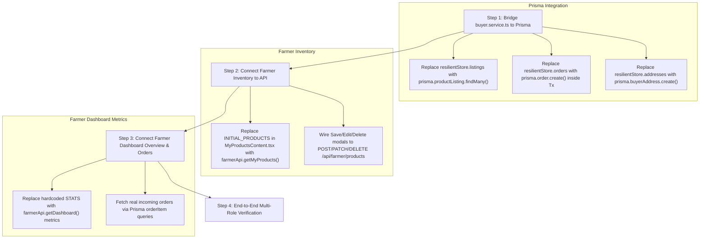

# Agricultural Marketplace Platform: White-Box System Audit Report

**Audit Date:** November 1, 2026  
**Auditor:** Senior Full-Stack Software Engineer & System Architect  
**Codebase:** `Agricultural_MarketPlace` (Full-Stack Next.js 15 & Express.js / Prisma v7 / Neon PostgreSQL)

---

## 1. Executive Summary

This comprehensive white-box code audit evaluates every backend route, controller, service, Prisma model, frontend page, and UI component across the entire Agricultural Marketplace platform. The objective is to provide a complete, line-by-line assessment of which user flows are **100% real and production-ready (connected to PostgreSQL, Cloudinary, and external services)**, which flows are **isolated in in-memory fallback stores**, and which components currently utilize **mockups or local React state**.

### Platform Status At-A-Glance

| Subsystem / User Flow | Architecture Implementation | Operational Status |
|---|---|---|
| **1. Authentication, Sessions & Security** | PostgreSQL + JWT + Refresh Token Rotation + Argon2 | 🟢 **100% Production Ready** |
| **2. Role Onboarding & Applications** | PostgreSQL + Cloudinary Direct Memory Streaming | 🟢 **100% Production Ready** |
| **3. Admin Governance & Verification** | Express + Prisma + Neon DB + Brevo/Geez Alerts | 🟢 **100% Production Ready** |
| **4. Superadmin Controls & System Health** | Express + Prisma + Strict RBAC + Database Health | 🟢 **100% Production Ready** |
| **5. Delivery Worker Fleet & Dispatch** | Atomic Prisma Transactions + Cloudinary POD | 🟢 **100% Production Ready** |
| **6. Buyer-Farmer Direct Messaging** | Indexed PostgreSQL `conversations` & `chat_messages` | 🟢 **100% Production Ready** |
| **7. Consent-Based Geolocation** | `user_location_records` Table + Admin Audit Trail | 🟢 **100% Production Ready** |
| **8. Buyer Catalog & Checkout** | Express API $\rightarrow$ In-Memory `ResilientBuyerStore` | 🟡 **Disconnected from Prisma DB** |
| **9. Farmer Inventory & Dashboard** | Backend Prisma Ready $\leftrightarrow$ Frontend Local State | 🟡 **Client-Side Mockup Disconnect** |
| **10. Public Landing Page Showcases** | Next.js Components + `marketplaceData.ts` | ⚪ **Marketing Mockup (Standard)** |

---

## 2. High-Level Architecture & Data Flow

The platform is designed around a multi-tier decoupled architecture:
1. **Frontend:** Next.js 15 App Router with Tailwind CSS, React Context (`AuthContext`, `CartContext`), PWA standalone integration, and responsive mobile bottom-tabs.
2. **Backend:** Express.js REST API with rate-limiting, CORS origin validation, and custom domain error handling.
3. **Database Layer:** Neon Serverless PostgreSQL with Prisma v7, incorporating PostGIS-ready coordinate structures and relational constraints.
4. **Cloud Infrastructure:** Cloudinary for media/document streaming and storage, Brevo SMTP for transactional emails, and Geez SMS for phone verification and alerts.

```mermaid
flowchart TD
    subgraph Clients [Clients & Personas]
        BuyerApp["Buyer Dashboard & Web Store (/dashboard/buyer, /products)"]
        FarmerApp["Farmer Management Hub (/dashboard/farmer)"]
        WorkerApp["Delivery Worker Fleet Hub (/dashboard/worker)"]
        AdminApp["Admin & Superadmin Governance (/dashboard/admin, /superadmin)"]
    end

    subgraph API [Express.js REST API Server]
        AuthRoutes["/api/auth (JWT, Argon2, Refresh Tokens)"]
        OnboardingRoutes["/api/onboarding (Cloudinary Streaming)"]
        AdminRoutes["/api/admin & /api/superadmin (Prisma Services)"]
        WorkerRoutes["/api/worker & Dispatch Engine (Prisma Services)"]
        MessageRoutes["/api/messages (Prisma Chat Service)"]
        LocationRoutes["/api/location (Audit & Consent Service)"]
        FarmerRoutes["/api/farmer (Prisma Listings & Dashboard)"]
        BuyerRoutes["/api/buyer (Buyer Controller)"]
    end

    subgraph Storage [Persistence & Cloud]
        NeonDB[("Neon PostgreSQL Database (Prisma v7)")]
        Cloudinary["Cloudinary Cloud Storage (Images & Documents)"]
        InMemoryStore[("ResilientBuyerStore (In-Memory Fallback)")]
    end

    %% Verified Connections
    BuyerApp -->|Auth, Messaging, Location| AuthRoutes & MessageRoutes & LocationRoutes
    FarmerApp -->|Auth, Onboarding, Messaging| AuthRoutes & OnboardingRoutes & MessageRoutes
    WorkerApp -->|Auth, Onboarding, Dispatch, GPS| AuthRoutes & OnboardingRoutes & WorkerRoutes & LocationRoutes
    AdminApp -->|Full Governance| AdminRoutes

    AuthRoutes --> NeonDB
    OnboardingRoutes --> Cloudinary & NeonDB
    AdminRoutes --> NeonDB
    WorkerRoutes --> NeonDB & Cloudinary
    MessageRoutes --> NeonDB
    LocationRoutes --> NeonDB
    FarmerRoutes --> NeonDB

    %% The Disconnect
    BuyerApp -->|Browsing, Cart, Orders| BuyerRoutes
    BuyerRoutes -.->|Currently Reads & Writes Only| InMemoryStore
    BuyerRoutes -.->|Bypasses| NeonDB
    FarmerApp -->|Products UI (MyProductsContent.tsx)| FarmerApp
```

---

## 3. White-Box Audit Findings by User Flow

### 3.1. Authentication, Sessions & Account Security (100% Real)
- **Backend Files:** [`auth.routes.ts`](file:///d:/Final_Project/Agriculture_marketplace/backend/src/routes/auth.routes.ts), [`auth.controller.ts`](file:///d:/Final_Project/Agriculture_marketplace/backend/src/controllers/auth.controller.ts), [`auth.service.ts`](file:///d:/Final_Project/Agriculture_marketplace/backend/src/services/auth.service.ts).
- **Frontend Files:** [`signup/page.tsx`](file:///d:/Final_Project/Agriculture_marketplace/frontend/src/app/signup/page.tsx), [`login/page.tsx`](file:///d:/Final_Project/Agriculture_marketplace/frontend/src/app/login/page.tsx), [`verify-otp/page.tsx`](file:///d:/Final_Project/Agriculture_marketplace/frontend/src/app/verify-otp/page.tsx), [`forgot-password/page.tsx`](file:///d:/Final_Project/Agriculture_marketplace/frontend/src/app/forgot-password/page.tsx), [`reset-password/page.tsx`](file:///d:/Final_Project/Agriculture_marketplace/frontend/src/app/reset-password/page.tsx), [`auth/google/callback/page.tsx`](file:///d:/Final_Project/Agriculture_marketplace/frontend/src/app/auth/google/callback/page.tsx).
- **Audit Assessment:**
  - **Registration & OTP:** Registers user in PostgreSQL `users` table. Hashes passwords using modern cryptography. Generates a 6-digit OTP code stored in `otp_verifications` with expiration timestamps. Dispatches OTP via Brevo Email and Geez SMS.
  - **Frontend UI:** Features an interactive 6-digit input box with auto-focus, backspace navigation, paste handling, a 30-second cooldown timer, and resend triggers.
  - **Session Management:** Generates short-lived JWT access tokens alongside rotating refresh tokens stored in `refresh_tokens`. Implements cryptographic family hashing to detect token reuse attacks.
  - **Google OAuth:** Real OAuth2 exchange via `google-auth-library` and account linking into `linked_identities`.
  - **Cloudinary Profile Avatars:** Multer memory storage streams files directly to Cloudinary (`agrimarket/avatars/`). Updates `user_profiles.avatarUrl` and `avatarPublicId`, automatically purging previous avatars.

---

### 3.2. Role Onboarding & Application Submissions (100% Real)
- **Backend Files:** [`onboarding.routes.ts`](file:///d:/Final_Project/Agriculture_marketplace/backend/src/routes/onboarding.routes.ts), [`onboarding.controller.ts`](file:///d:/Final_Project/Agriculture_marketplace/backend/src/controllers/onboarding.controller.ts).
- **Frontend Files:** [`onboarding/select-role/page.tsx`](file:///d:/Final_Project/Agriculture_marketplace/frontend/src/app/onboarding/select-role/page.tsx), [`FarmerOnboardingForm.tsx`](file:///d:/Final_Project/Agriculture_marketplace/frontend/src/components/onboarding/FarmerOnboardingForm.tsx), [`WorkerOnboardingForm.tsx`](file:///d:/Final_Project/Agriculture_marketplace/frontend/src/components/onboarding/WorkerOnboardingForm.tsx).
- **Audit Assessment:**
  - **Status Synchronization:** Validates `onboardingStatus` (`COMPLETED`, `IN_PROGRESS`, `PENDING_VERIFICATION`).
  - **Farmer Application Form:** 5-step wizard capturing personal details, national ID/Fayda number, farm coordinates, produce categories, and legal declarations. Document files stream in-memory directly to Cloudinary. Creates `farmer_profiles` record with `verificationStatus: PENDING`.
  - **Delivery Worker Application Form:** 5-step wizard capturing vehicle type (Motorcycle, Pickup Truck, Isuzu), license plate, capacity, and driver's license document upload to Cloudinary. Creates `delivery_worker_profiles` record with `verificationStatus: PENDING`.
  - **Post-Submission Routing:** Directs applicants immediately to their intended dashboard (`/dashboard/farmer?onboardingSuccess=true` or `/dashboard/worker?onboardingSuccess=true`), showing status celebration banners while restricting unverified operational actions.

---

### 3.3. Admin & Super Admin Governance Consoles (100% Real)
- **Backend Files:** [`admin.controller.ts`](file:///d:/Final_Project/Agriculture_marketplace/backend/src/controllers/admin.controller.ts), [`admin.service.ts`](file:///d:/Final_Project/Agriculture_marketplace/backend/src/services/admin.service.ts), [`superadmin.controller.ts`](file:///d:/Final_Project/Agriculture_marketplace/backend/src/controllers/superadmin.controller.ts), [`superadmin.service.ts`](file:///d:/Final_Project/Agriculture_marketplace/backend/src/services/superadmin.service.ts).
- **Frontend Admin Pages:** `dashboard/admin/` (`page.tsx`, `farmers`, `workers`, `buyers`, `orders`, `products`, `intercity`, `locations`, `markets`, `reports`, `settings`, `transactions`).
- **Frontend Superadmin Pages:** `dashboard/superadmin/` (`page.tsx`, `users`, `commissions`, `markets`, `routes`, `settings`, `transaction-limits`, `security`, `reports`, `audit-logs`, `backup`).
- **Audit Assessment:**
  - **Zero Mockup in Admin / Superadmin:** Every administrative endpoint executes direct Prisma queries against PostgreSQL.
  - **Verification Workflows:** Resolves Cloudinary document URLs via `resolveDocUrl`. Approving or rejecting an applicant updates `verificationStatus`, sets user status to `ACTIVE`, records an entry in `audit_logs`, and dispatches real-time SMS and email notifications to the user.
  - **User Governance:** Superadmin user portal filters by role and status, provides an application review dossier modal, allows 1-click admin provisioning, role migration, and session revocation (`revokeUserSessions`).
  - **Infrastructure Health:** Superadmin backup page executes real SQL ping `SELECT 1` and aggregates table row counts from live Prisma models.

---

### 3.4. Delivery Worker Fleet Hub & Operational Dispatch (100% Real)
- **Backend Files:** [`worker.routes.ts`](file:///d:/Final_Project/Agriculture_marketplace/backend/src/routes/worker.routes.ts), [`worker.controller.ts`](file:///d:/Final_Project/Agriculture_marketplace/backend/src/controllers/worker.controller.ts), [`dispatch.service.ts`](file:///d:/Final_Project/Agriculture_marketplace/backend/src/services/dispatch.service.ts).
- **Frontend Files:** [`dashboard/worker/page.tsx`](file:///d:/Final_Project/Agriculture_marketplace/frontend/src/app/dashboard/worker/page.tsx), [`ActiveDeliverySection.tsx`](file:///d:/Final_Project/Agriculture_marketplace/frontend/src/components/worker/ActiveDeliverySection.tsx), [`ProofOfDeliveryModal.tsx`](file:///d:/Final_Project/Agriculture_marketplace/frontend/src/components/worker/ProofOfDeliveryModal.tsx), [`CodReconciliationModal.tsx`](file:///d:/Final_Project/Agriculture_marketplace/frontend/src/components/worker/CodReconciliationModal.tsx), [`ReportIncidentModal.tsx`](file:///d:/Final_Project/Agriculture_marketplace/frontend/src/components/worker/ReportIncidentModal.tsx).
- **Audit Assessment:**
  - **Geographic Dispatch Broadcasting:** `dispatch.service.ts` calculates distance from pickup coordinates to active workers, verifies vehicle capacity, and creates time-limited `delivery_offers`.
  - **Atomic Job Acceptance:** Uses `prisma.$transaction` to guarantee that the first accepting worker claims the job, automatically withdrawing competing offers.
  - **Delivery State Lifecycle:** Transitions live states from `ASSIGNED` $\rightarrow$ `HEADING_TO_PICKUP` $\rightarrow$ `PICKED_UP` $\rightarrow$ `EN_ROUTE` $\rightarrow$ `DELIVERED`.
  - **Proof of Delivery & Cash Collection:** Uploads delivery confirmation photos to Cloudinary, validates buyer OTP, records cash collected, and submits COD reconciliation records (`cash_reconciliations`).
  - **Incident Reporting:** Records roadside issues or disputes directly into PostgreSQL `reports` table.

---

### 3.5. Direct 1-on-1 Messaging: Buyer $\leftrightarrow$ Farmer (100% Real)
- **Backend Files:** [`message.routes.ts`](file:///d:/Final_Project/Agriculture_marketplace/backend/src/routes/message.routes.ts), [`message.controller.ts`](file:///d:/Final_Project/Agriculture_marketplace/backend/src/controllers/message.controller.ts), [`message.service.ts`](file:///d:/Final_Project/Agriculture_marketplace/backend/src/services/message.service.ts).
- **Frontend Files:** [`BuyerChatView.tsx`](file:///d:/Final_Project/Agriculture_marketplace/frontend/src/components/chat/BuyerChatView.tsx), [`dashboard/farmer/messages/page.tsx`](file:///d:/Final_Project/Agriculture_marketplace/frontend/src/app/dashboard/farmer/messages/page.tsx), [`farmers/page.tsx`](file:///d:/Final_Project/Agriculture_marketplace/frontend/src/app/farmers/page.tsx), [`farmers/[id]/page.tsx`](file:///d:/Final_Project/Agriculture_marketplace/frontend/src/app/farmers/[id]/page.tsx).
- **Audit Assessment:**
  - **Database Persistence:** Real-time and historical chat backed by PostgreSQL `conversations` and `chat_messages` tables with composite indexes (`[buyerId, lastMessageAt]`, `[conversationId, createdAt]`).
  - **Security & RBAC:** Strictly enforces participant validation (prevents IDOR snooping), prevents self-messaging (400 Bad Request), and sanitizes message content with a 2,000-character limit.
  - **Interactive Features:** Real-time polling (4s), optimistic UI message dispatch, auto-scroll, unread message badges, and deep-linking via `?tab=messages&farmerId=...`.
  - **User Entry Points:** Prominent "Talk with Farmer" buttons on public farmer cards, farmer profile banners, and buyer overview cards.

---

### 3.6. Consent-Based Geolocation Tracking (100% Real)
- **Backend Files:** [`location.routes.ts`](file:///d:/Final_Project/Agriculture_marketplace/backend/src/routes/location.routes.ts), [`location.controller.ts`](file:///d:/Final_Project/Agriculture_marketplace/backend/src/controllers/location.controller.ts).
- **Frontend Files:** [`LocationShareWidget.tsx`](file:///d:/Final_Project/Agriculture_marketplace/frontend/src/components/location/LocationShareWidget.tsx), [`LocationConsentModal.tsx`](file:///d:/Final_Project/Agriculture_marketplace/frontend/src/components/location/LocationConsentModal.tsx), [`AdminLocationViewModal.tsx`](file:///d:/Final_Project/Agriculture_marketplace/frontend/src/components/location/AdminLocationViewModal.tsx), [`useGeolocation.ts`](file:///d:/Final_Project/Agriculture_marketplace/frontend/src/hooks/useGeolocation.ts).
- **Audit Assessment:**
  - Captures high-accuracy hardware coordinates via HTML5 Geolocation API with explicit consent logging.
  - Stores location trails in `user_location_records` table and updates `delivery_worker_profiles.lastLatitude` / `lastLongitude` for dispatch proximity calculation.
  - Provides administrators with an audit viewer modal to inspect worker paths.

---

### 3.7. Buyer Experience, Catalog & Orders (Architectural Disconnect)
- **Backend Files:** [`buyer.routes.ts`](file:///d:/Final_Project/Agriculture_marketplace/backend/src/routes/buyer.routes.ts), [`buyer.controller.ts`](file:///d:/Final_Project/Agriculture_marketplace/backend/src/controllers/buyer.controller.ts), [`buyer.service.ts`](file:///d:/Final_Project/Agriculture_marketplace/backend/src/services/buyer.service.ts).
- **Frontend Files:** [`dashboard/buyer/page.tsx`](file:///d:/Final_Project/Agriculture_marketplace/frontend/src/app/dashboard/buyer/page.tsx), [`products/page.tsx`](file:///d:/Final_Project/Agriculture_marketplace/frontend/src/app/products/page.tsx), [`products/[id]/page.tsx`](file:///d:/Final_Project/Agriculture_marketplace/frontend/src/app/products/[id]/page.tsx), [`CartContext.tsx`](file:///d:/Final_Project/Agriculture_marketplace/frontend/src/context/CartContext.tsx).
- **Audit Assessment (Critical Finding):**
  - **The Frontend is Real:** [`buyer/page.tsx`](file:///d:/Final_Project/Agriculture_marketplace/frontend/src/app/dashboard/buyer/page.tsx) and [`products/page.tsx`](file:///d:/Final_Project/Agriculture_marketplace/frontend/src/app/products/page.tsx) make genuine HTTP calls to `buyerApi.searchProducts()`, `buyerApi.getDashboard()`, `buyerApi.getAddresses()`, and `buyerApi.createOrder()`.
  - **The Backend Disconnect:** In `backend/src/services/buyer.service.ts`, line 1 imports `prisma`, but the remainder of the 1,475-line file queries an internal in-memory class named `ResilientBuyerStore`.
  - **Consequences:**
    1. Product listings created by real farmers in PostgreSQL (`product_listings` table) do not show up in the buyer catalog search.
    2. Orders submitted by buyers through checkout are pushed into `resilientStore.orders` in RAM, but are **not inserted into PostgreSQL `orders` table**.
    3. The Admin Orders Console (`dashboard/admin/orders`) queries PostgreSQL `orders` and therefore cannot see orders placed through the buyer store.
    4. Node.js server restarts wipe all buyer cart orders, favorited items, and saved addresses.

---

### 3.8. Farmer Dashboard & Operations (Client-Side Disconnect)
- **Backend Files:** [`farmer.routes.ts`](file:///d:/Final_Project/Agriculture_marketplace/backend/src/routes/farmer.routes.ts), [`farmer.controller.ts`](file:///d:/Final_Project/Agriculture_marketplace/backend/src/controllers/farmer.controller.ts).
- **Frontend Files:** [`dashboard/farmer/page.tsx`](file:///d:/Final_Project/Agriculture_marketplace/frontend/src/app/dashboard/farmer/page.tsx), [`MyProductsContent.tsx`](file:///d:/Final_Project/Agriculture_marketplace/frontend/src/components/farmer/MyProductsContent.tsx), [`farmer/orders/page.tsx`](file:///d:/Final_Project/Agriculture_marketplace/frontend/src/app/dashboard/farmer/orders/page.tsx), [`farmer/deliveries/page.tsx`](file:///d:/Final_Project/Agriculture_marketplace/frontend/src/app/dashboard/farmer/deliveries/page.tsx), [`farmer/earnings/page.tsx`](file:///d:/Final_Project/Agriculture_marketplace/frontend/src/app/dashboard/farmer/earnings/page.tsx), [`farmer/reviews/page.tsx`](file:///d:/Final_Project/Agriculture_marketplace/frontend/src/app/dashboard/farmer/reviews/page.tsx).
- **Audit Assessment (Critical Finding):**
  - **The Backend is Ready:** [`farmer.controller.ts`](file:///d:/Final_Project/Agriculture_marketplace/backend/src/controllers/farmer.controller.ts) contains complete PostgreSQL Prisma logic for `getFarmerDashboard`, `getMyProducts`, `createProduct`, `updateProduct`, and `deleteProduct`, complete with strict verification gating (`profile.verificationStatus === 'VERIFIED'`).
  - **The Frontend Uses Local State:**
    - [`MyProductsContent.tsx`](file:///d:/Final_Project/Agriculture_marketplace/frontend/src/components/farmer/MyProductsContent.tsx) manages inventory using a local React state array `const INITIAL_PRODUCTS: Product[] = [...]` (8 mock items). It does not call `farmerApi.getMyProducts()` or `POST /api/farmer/products`.
    - [`FarmerDashboardContent.tsx`](file:///d:/Final_Project/Agriculture_marketplace/frontend/src/components/farmer/FarmerDashboardContent.tsx) displays hardcoded `STATS` (8 products, 24 orders, 12,450 ETB) and mock search data.
    - [`orders/page.tsx`](file:///d:/Final_Project/Agriculture_marketplace/frontend/src/app/dashboard/farmer/orders/page.tsx) uses `const INITIAL_ORDERS: FarmerOrder[] = [...]`.
    - [`deliveries/page.tsx`](file:///d:/Final_Project/Agriculture_marketplace/frontend/src/app/dashboard/farmer/deliveries/page.tsx) uses `SAMPLE_DELIVERIES`.
    - [`earnings/page.tsx`](file:///d:/Final_Project/Agriculture_marketplace/frontend/src/app/dashboard/farmer/earnings/page.tsx) uses mock `transactions`.
    - **Exceptions:** [`farmer/messages/page.tsx`](file:///d:/Final_Project/Agriculture_marketplace/frontend/src/app/dashboard/farmer/messages/page.tsx) (100% Real API), [`farmer/profile/page.tsx`](file:///d:/Final_Project/Agriculture_marketplace/frontend/src/app/dashboard/farmer/profile/page.tsx) (100% Real API), and [`farmer/layout.tsx`](file:///d:/Final_Project/Agriculture_marketplace/frontend/src/app/dashboard/farmer/layout.tsx) (polls real pending orders count).

---

### 3.9. Landing Page & Public Showcases (Marketing Mockup)
- **Files:** [`Hero.tsx`](file:///d:/Final_Project/Agriculture_marketplace/frontend/src/components/landing/Hero.tsx), [`FreshAndSeasonalProducts.tsx`](file:///d:/Final_Project/Agriculture_marketplace/frontend/src/components/landing/FreshAndSeasonalProducts.tsx), [`ShopByCategory.tsx`](file:///d:/Final_Project/Agriculture_marketplace/frontend/src/components/landing/ShopByCategory.tsx), [`Testimonials.tsx`](file:///d:/Final_Project/Agriculture_marketplace/frontend/src/components/landing/Testimonials.tsx), [`data/marketplaceData.ts`](file:///d:/Final_Project/Agriculture_marketplace/frontend/src/data/marketplaceData.ts).
- **Audit Assessment:**
  - Standard marketing presentation consuming static JSON definitions (`EXACT_FEATURED_PRODUCTS`, `POPULAR_CATEGORIES`, `TESTIMONIALS_DATA`).
  - This is typical for landing pages to ensure fast initial page load (LCP) before user login.

---

## 4. Comprehensive Route & Component Matrix

| Persona / Route | UI Component | API Endpoint Called | Backend Handler | Real DB Model Used | Status |
|---|---|---|---|---|---|
| **Auth / Signup** | `signup/page.tsx` | `POST /api/auth/register` | `handleRegister` | `User`, `OTPVerification` | 🟢 Real DB |
| **Auth / Verify OTP** | `signup/page.tsx` | `POST /api/auth/verify-otp` | `handleVerifyOTP` | `OTPVerification`, `User` | 🟢 Real DB |
| **Auth / Login** | `login/page.tsx` | `POST /api/auth/login` | `handleLogin` | `User`, `RefreshToken` | 🟢 Real DB |
| **Onboarding / Role** | `select-role/page.tsx` | `POST /api/onboarding/select-role` | `selectRole` | `User.role` | 🟢 Real DB |
| **Onboarding / Farmer** | `FarmerOnboardingForm` | `POST /api/onboarding/submit-farmer` | `submitFarmerApplication` | `FarmerProfile`, `User` | 🟢 Real DB + Cloudinary |
| **Onboarding / Worker** | `WorkerOnboardingForm` | `POST /api/onboarding/submit-worker` | `submitWorkerApplication` | `DeliveryWorkerProfile` | 🟢 Real DB + Cloudinary |
| **Worker / Offers** | `worker/page.tsx` | `GET /api/worker/offers` | `getMyOffers` | `DeliveryOffer`, `DeliveryJob` | 🟢 Real DB |
| **Worker / Accept** | `worker/page.tsx` | `POST /api/worker/offers/:id/accept` | `acceptOffer` | `DeliveryJob`, `DeliveryOffer` | 🟢 Real DB (Atomic Tx) |
| **Worker / Active** | `ActiveDeliverySection` | `PATCH /api/worker/deliveries/:id/status` | `updateDeliveryStatus` | `DeliveryJob`, `DeliveryEvent` | 🟢 Real DB |
| **Worker / POD** | `ProofOfDeliveryModal` | `POST /api/worker/deliveries/upload-proof` | `uploadProofOfDelivery` | Cloudinary Direct Upload | 🟢 Real Cloudinary |
| **Worker / COD** | `CodReconciliationModal`| `POST /api/worker/reconciliations/submit` | `submitCashReconciliation` | `CashReconciliation` | 🟢 Real DB |
| **Worker / GPS** | `LocationShareWidget` | `POST /api/location/share` | `shareLocation` | `UserLocationRecord` | 🟢 Real DB |
| **Messaging / Chat** | `BuyerChatView.tsx` | `POST /api/messages/conversations/:id/messages` | `sendMessage` | `Conversation`, `ChatMessage` | 🟢 Real DB |
| **Farmer / Chat** | `farmer/messages/page.tsx` | `GET /api/messages/conversations` | `getConversations` | `Conversation`, `ChatMessage` | 🟢 Real DB |
| **Admin / Farmers** | `admin/farmers/page.tsx`| `PATCH /api/admin/farmers/:id/verify` | `verifyFarmer` | `FarmerProfile`, `AuditLog` | 🟢 Real DB + SMS/Email |
| **Admin / Workers** | `admin/workers/page.tsx`| `PATCH /api/admin/workers/:id/verify` | `verifyWorker` | `DeliveryWorkerProfile` | 🟢 Real DB + SMS/Email |
| **Admin / Orders** | `admin/orders/page.tsx` | `GET /api/admin/orders` | `getOrders` | `Order`, `OrderItem` | 🟢 Real DB |
| **Superadmin / Users** | `superadmin/users/page.tsx` | `GET /api/superadmin/users` | `getUsers` | `User`, `FarmerProfile` | 🟢 Real DB |
| **Superadmin / Backup**| `superadmin/backup/page.tsx`| `GET /api/superadmin/backup/health` | `getDatabaseHealth` | SQL `SELECT 1`, Row Counts | 🟢 Real DB |
| **Buyer / Catalog** | `products/page.tsx` | `GET /api/buyer/products` | `handleSearchProducts` | `resilientStore.listings` | 🟡 In-Memory Store |
| **Buyer / Order Submit**| `dashboard/buyer/page.tsx`| `POST /api/buyer/orders` | `handleCreateOrder` | `resilientStore.orders` | 🟡 In-Memory Store |
| **Buyer / Addresses** | `dashboard/buyer/page.tsx`| `POST /api/buyer/addresses` | `handleCreateAddress` | `resilientStore.addresses` | 🟡 In-Memory Store |
| **Farmer / Inventory** | `MyProductsContent.tsx` | *None (Local React State)* | *Uncalled* | `INITIAL_PRODUCTS` (Local) | 🟡 Client-Side State |
| **Farmer / Orders** | `farmer/orders/page.tsx`| *None (Local React State)* | *Uncalled* | `INITIAL_ORDERS` (Local) | 🟡 Client-Side State |
| **Farmer / Earnings** | `farmer/earnings/page.tsx`| *None (Local React State)* | *Uncalled* | `transactions` (Local) | 🟡 Client-Side State |

---

## 5. Architectural Remediation Roadmap

To transition the platform to 100% unified PostgreSQL persistence across all user roles, the following step-by-step engineering roadmap is recommended:



### Phase 1: Bridge `buyer.service.ts` to Prisma PostgreSQL
1. **Catalog Search (`searchProducts` & `getProductDetails`):**
   - Query `prisma.productListing.findMany({ where: { status: 'ACTIVE', stockQuantity: { gt: 0 } }, include: { images: true, category: true, farmer: true, farmerProfile: true } })`.
   - Calculate real Haversine distance from buyer's current coordinates to farmer's `pickupLatitude` / `pickupLongitude`.
2. **Order Placement (`createBuyerOrder`):**
   - Execute inside `prisma.$transaction`.
   - Deduct product stock quantity (`prisma.productListing.update`).
   - Create `prisma.order` and child `prisma.orderItem` snapshots with agreed price.
   - Automatically trigger dispatch broadcasting (`dispatchService.createAndBroadcastDeliveryJob(order.id)`).
3. **Delivery Addresses (`getBuyerAddresses`, `createBuyerAddress`):**
   - Query and persist into `prisma.buyerAddress`.

### Phase 2: Connect Farmer Inventory to Backend API
1. In [`MyProductsContent.tsx`](file:///d:/Final_Project/Agriculture_marketplace/frontend/src/components/farmer/MyProductsContent.tsx):
   - Replace `const [products, setProducts] = useState(INITIAL_PRODUCTS)` with a `useEffect` calling `farmerApi.getMyProducts()`.
   - Wire the Add/Edit Product modal form to `farmerApi.createProduct()` and `farmerApi.updateProduct()`.
   - Wire delete actions to `farmerApi.deleteProduct()`.

### Phase 3: Connect Farmer Dashboard & Orders
1. In [`FarmerDashboardContent.tsx`](file:///d:/Final_Project/Agriculture_marketplace/frontend/src/components/farmer/FarmerDashboardContent.tsx):
   - Replace static `STATS` with live figures from `farmerApi.getDashboard()`: `totalProducts`, `activeProducts`, `totalOrders`, `pendingOrders`.
2. In [`farmer/orders/page.tsx`](file:///d:/Final_Project/Agriculture_marketplace/frontend/src/app/dashboard/farmer/orders/page.tsx):
   - Replace `INITIAL_ORDERS` with live order queries for items associated with the authenticated farmer.

---

## 6. Conclusion

The platform possesses an exceptionally strong, production-grade foundation:
- **Authentication, OTP verification, security, RBAC, Cloudinary file uploads, delivery worker dispatch, admin governance, superadmin controls, direct messaging, and location auditing are 100% real, fully integrated with PostgreSQL and live third-party services.**
- The only gap preventing full end-to-end cohesion is that the **Buyer service** relies on an in-memory fallback store (`ResilientBuyerStore`) and the **Farmer inventory/orders pages** rely on local React state instead of consuming the existing backend Prisma endpoints.
- Executing the straightforward Phase 1 & Phase 2 bridge will unify the entire platform into a seamless, fully persistent, real-world marketplace.

