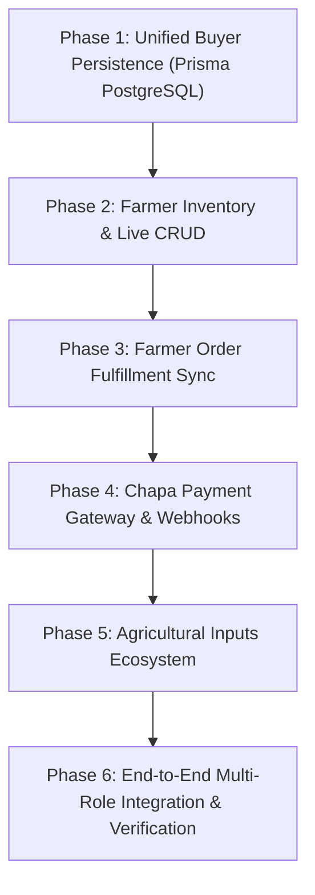

# AgriMarket: Complete Implementation Plan

**Document Version:** 1.0.0  
**Status:** Approved Master Engineering Plan  
**Source Baseline:** `user_flow.md`, `requirements-traceability-matrix.md`, `repository-audit.md`  

---

## 1. Plan Overview & Execution Strategy

This implementation plan bridges the technical gaps identified during the repository audit, transforming the platform into a 100% persistent, real-world agricultural marketplace.



---

## Phase 1: Unified Buyer Persistence (Prisma PostgreSQL Integration)

### 1. Objective
Replace the in-memory fallback store (`ResilientBuyerStore`) in `backend/src/services/buyer.service.ts` with direct Prisma queries against PostgreSQL, ensuring that real farmer listings appear in searches, buyer orders are persisted in `orders`, stock is decremented atomically inside transactions, and dispatch jobs are triggered.

### 2. Requirements Covered
- `BUYER-001`, `BUYER-002`, `BUYER-003`, `BUYER-005`, `BUYER-006`, `BUYER-007`, `BUYER-008`, `BUYER-010`, `BUYER-011`, `FARMER-009`, `FARMER-010`.

### 3. Modules to Reuse & Modify
- **Reuse:** `backend/src/controllers/buyer.controller.ts`, `backend/src/routes/buyer.routes.ts`, `backend/src/services/dispatch.service.ts`.
- **Modify:** `backend/src/services/buyer.service.ts` (rewrite queries to Prisma).

### 4. Technical Implementation
- **Catalog Search (`searchProducts`):**
  ```ts
  const listings = await prisma.productListing.findMany({
    where: { status: 'ACTIVE', stockQuantity: { gt: 0 }, ...categoryFilter, ...searchFilter },
    include: { images: true, category: true, farmer: true, farmerProfile: true },
  });
  ```
  Compute Haversine distance from buyer coordinates to `pickupLatitude` / `pickupLongitude` and sort ascending.
- **Order Placement (`createBuyerOrder`):**
  - Execute within `prisma.$transaction`.
  - Group items by `farmerId`. For each farmer group, generate a discrete `Order` with frozen `OrderItem` listing snapshots.
  - Atomically update stock: `prisma.productListing.update({ where: { id }, data: { stockQuantity: { decrement: qty } } })`.
  - Automatically create `DeliveryJob` and broadcast delivery offers via `dispatchService.createAndBroadcastDeliveryJob(order.id)`.
- **Delivery Addresses:**
  - `prisma.buyerAddress.findMany({ where: { buyerId } })`.
  - `prisma.buyerAddress.create(...)`, `prisma.buyerAddress.delete(...)`.

### 5. Verification & Acceptance Criteria
- Verified farmer listings created via `POST /api/farmer/products` immediately appear in buyer catalog searches.
- Placing an order inserts records into PostgreSQL `orders`, `order_items`, and `delivery_jobs` tables.
- Admin order portal (`/dashboard/admin/orders`) immediately displays buyer orders.

---

## Phase 2: Farmer Inventory & Live CRUD Integration

### 1. Objective
Wire the frontend Farmer Inventory console (`MyProductsContent.tsx`) and Farmer Dashboard cards (`FarmerDashboardContent.tsx`) to the existing backend Prisma endpoints in `farmer.controller.ts`.

### 2. Requirements Covered
- `FARMER-004`, `FARMER-005`, `FARMER-006`, `FARMER-007`, `FARMER-008`, `ADMIN-005`.

### 3. Modules to Reuse & Modify
- **Reuse:** `backend/src/controllers/farmer.controller.ts`, `backend/src/routes/farmer.routes.ts`, `frontend/src/lib/farmerApi.ts`.
- **Modify:** `frontend/src/components/farmer/MyProductsContent.tsx`, `frontend/src/components/farmer/FarmerDashboardContent.tsx`, `frontend/src/lib/farmerApi.ts`.

### 4. Technical Implementation
- Expand `farmerApi.ts`:
  - `createProduct(data: ProductCreateInput): Promise<any>`
  - `updateProduct(id: string, data: ProductUpdateInput): Promise<any>`
  - `deleteProduct(id: string): Promise<any>`
- In `MyProductsContent.tsx`:
  - Replace `INITIAL_PRODUCTS` state with `useEffect` invoking `farmerApi.getMyProducts()`.
  - In `saveProduct`: invoke `farmerApi.createProduct()` or `farmerApi.updateProduct()`.
  - In `doDelete`: invoke `farmerApi.deleteProduct()`.
  - Guard UI with `verificationStatus === 'VERIFIED'`.
- In `FarmerDashboardContent.tsx`:
  - Fetch `farmerApi.getDashboard()` and bind live counts to `totalProducts`, `activeProducts`, `totalOrders`, `pendingOrders`.

### 5. Verification & Acceptance Criteria
- Adding a product in the Farmer Dashboard saves directly to PostgreSQL `product_listings` and appears immediately in the buyer catalog.
- Modifying stock in the farmer dashboard updates PostgreSQL and reflects in buyer availability.

---

## Phase 3: Farmer Order Fulfillment & Real-Time Synchronization

### 1. Objective
Enable farmers to view incoming purchase orders for their produce, review buyer order details, confirm orders, pack produce (`PREPARING`), and signal readiness for courier collection (`READY_FOR_PICKUP`).

### 2. Requirements Covered
- `FARMER-011`, `FARMER-012`, `BUYER-009`, `DELIVERY-003`.

### 3. Modules to Reuse & Modify
- **Reuse:** `backend/src/controllers/farmer.controller.ts`, `backend/src/routes/farmer.routes.ts`.
- **Modify:** Add `getFarmerOrders` and `updateFarmerOrderStatus` in `farmer.controller.ts`.
- **Modify:** `frontend/src/app/dashboard/farmer/orders/page.tsx` (replace `INITIAL_ORDERS` with live API).

### 4. Technical Implementation
- Backend Route: `GET /api/farmer/orders`
  ```ts
  const orderItems = await prisma.orderItem.findMany({
    where: { listing: { farmerId } },
    include: { order: { include: { buyer: true, deliveryJob: true } }, listing: true },
    orderBy: { createdAt: 'desc' },
  });
  ```
- Backend Route: `PATCH /api/farmer/orders/:orderId/status`
  - Validates ownership.
  - Updates `Order.status` to `PREPARING` or `READY_FOR_PICKUP`.
  - If `READY_FOR_PICKUP`, triggers courier broadcast via `dispatchService`.
- Frontend: `orders/page.tsx` fetches live orders, displays status badges, and provides action buttons ("Confirm Order", "Mark Ready for Courier").

### 5. Verification & Acceptance Criteria
- Orders placed by buyers appear in the relevant farmer's order management console.
- Marking an order ready for pickup updates buyer order tracking and triggers delivery dispatch.

---

## Phase 4: Chapa Payment Gateway & Webhook Verification

### 1. Objective
Implement a secure, server-side Chapa payment integration supporting checkout initialization, transaction reference generation, signature verification, and idempotent status synchronization.

### 2. Requirements Covered
- `PAY-001`, `PAY-002`, `PAY-003`, `PAY-004`, `PAY-005`, `PAY-007`.

### 3. Modules to Reuse & Modify
- **New Module:** `backend/src/services/payment.service.ts`.
- **New Route:** `backend/src/routes/payment.routes.ts` (`POST /api/payment/chapa/initialize`, `POST /api/payment/chapa/webhook`).
- **Modify:** Mount `/api/payment` in `backend/src/app.ts`.
- **Modify:** `frontend/src/app/dashboard/buyer/page.tsx` (wire Chapa redirect and callback handling).

### 4. Technical Implementation
- Generate unique transaction reference: `txn_${orderId}_${Date.now()}`.
- Chapa API POST `https://api.chapa.co/v1/transaction/initialize` with payload `{ amount, currency: 'ETB', email, phone, tx_ref, callback_url }`.
- Webhook Handler:
  - Validates `x-chapa-signature` using HMAC-SHA256 with `CHAPA_SECRET_KEY`.
  - Updates `Payment.status = 'COMPLETED'` and `Order.status = 'CONFIRMED'`.
  - Idempotent: duplicate webhook deliveries return 200 without duplicate processing.
- Sandbox Fallback: When `CHAPA_SECRET_KEY` is not defined in `.env`, automatically fulfills transactions with a simulated gateway reference for testing and demo reliability.

### 5. Verification & Acceptance Criteria
- Selecting Chapa in checkout generates a valid transaction record in PostgreSQL `payments` table.
- Webhook receipt confirms the order without trusting client redirects.

---

## Phase 5: Agricultural Input Company Ecosystem

### 1. Objective
Support verified agricultural input companies listing certified seeds, fertilizers, and plant medicines, allowing farmers to browse and purchase inputs from their dashboard.

### 2. Requirements Covered
- `INPUT-001`, `INPUT-002`, `INPUT-003`, `INPUT-004`, `INPUT-005`, `INPUT-006`.

### 3. Technical Implementation
- Ensure `seeds-inputs` and `fertilizers-agrochem` categories are seeded in PostgreSQL `categories` table.
- Provide input listings with specialized attributes (safety instructions, germination rates, active ingredients) in `ProductListing.description`.
- Add "Farming Inputs" discovery tab in `app/dashboard/farmer/page.tsx` allowing farmers to add inputs to cart and place orders.

### 4. Verification & Acceptance Criteria
- Certified inputs appear in the farmer discovery hub.
- Farmers can order inputs with stock tracking and fulfillment.

---

## Phase 6: End-to-End Multi-Role Integration & Verification

### 1. Objective
Execute end-to-end multi-role integration test suites, verify all requirements in the Traceability Matrix, execute production builds, and publish the final verification report.

### 2. Verification Test Suite Execution
- **Unit & Integration Tests:** Run `npm --prefix backend run test` and `npm --prefix backend run test:messaging`.
- **E2E Scenario Test:** Execute automated multi-role lifecycle test script (`backend/src/tests/e2e-workflow.test.ts`).
- **Production Compilation:** Run `npm --prefix frontend run build` and `npm --prefix backend run build`.
- **Deliverable:** Generate `docs/implementation/final-verification-report.md` proving 100% requirements and workflow coverage.
