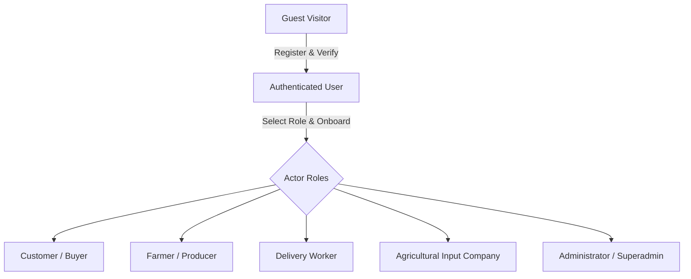
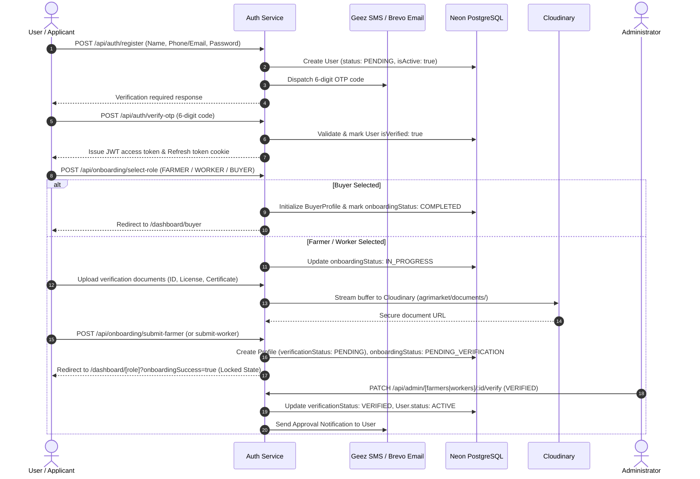
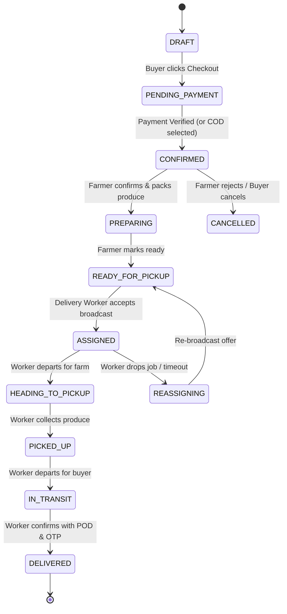

# AgriMarket: Requirements Analysis & Domain Specification

**Document Version:** 1.0.0  
**Status:** Authoritative Specification  
**Source Document:** `user_flow.md`  
**Target Architecture:** Next.js 15 App Router, Express.js REST API, Prisma v7, Neon PostgreSQL, Cloudinary, Brevo SMTP, Geez SMS  

---

## 1. System Purpose & Business Objectives

AgriMarket is a production-oriented, direct farmer-to-consumer and business-to-business agricultural marketplace designed specifically for the Ethiopian agricultural sector. Its core purpose is to:
1. **Eliminate Exploitative Intermediaries:** Connect rural and peri-urban smallholder and commercial farmers directly with urban households, restaurants, institutions, and bulk buyers.
2. **Guarantee Farmer Pricing Autonomy:** Farmers own and determine their product prices in Ethiopian Birr (ETB). The platform never silently discounts, overrides, or forces price ceilings without explicit farmer consent.
3. **Location-Centric Discovery & Distance Ranking:** Products and farmers are ranked and discovered based on proximity, showing the closest eligible farmers first to minimize transit decay, optimize freshness, and reduce local delivery costs.
4. **Controlled Cross-City & Intercity Logistics:** Support large-volume, bulk agricultural trade across Ethiopian regional corridors (e.g. Oromia, Sidama, Amhara to Addis Ababa, Dire Dawa) utilizing freight trucks with administrative oversight, quantity thresholds, and dedicated intercity routing rules.
5. **Integrated Last-Mile Delivery Fleet:** Coordinate independent local delivery workers (motorcycles, three-wheelers, pickup trucks) through real-time proximity broadcasting, atomic job acceptance, and digital proof-of-delivery (POD).
6. **Agricultural Inputs Ecosystem:** Enable certified agricultural input companies to list and distribute farming inputs, certified seeds, fertilizers, and approved agricultural medicines to farmers.
7. **Transparent Governance & Financial Auditing:** Comprehensive administrative moderation, dispute arbitration, cash-on-delivery (COD) reconciliation, and immutable audit logs.

---

## 2. Platform Roles, Permissions & Actor Responsibilities

The system defines five primary actors, each mapped to strict authorization boundaries:

### 2.1. Guest Visitor
- **Capabilities:** Public homepage browsing, category discovery, product catalog browsing, product searching, keyword and category filtering, viewing public farmer profile cards, inspecting unit prices and available quantities, exploring supported delivery cities.
- **Restrictions:** Cannot initiate checkout, add items to cart, place orders, chat with farmers, or access private dashboards. All transactional actions trigger authentication modals with safe return redirects.

### 2.2. Customer / Buyer (`Role.BUYER`)
- **Capabilities:** Manage buyer profile and delivery addresses; location-based farmer and product discovery; nearest-first ranking; cart management; server-side verified checkout; choosing payment methods (Telebirr, CBEBirr, Chapa, Cash on Delivery); real-time order tracking; direct 1-on-1 messaging with farmers; saving favorite farmers and products; submitting support tickets and complaints.
- **Permissions:** Restricted strictly to self-owned orders, addresses, and chat threads. Prohibited from accessing farmer, worker, or admin operational portals.

### 2.3. Farmer / Agricultural Producer (`Role.FARMER`)
- **Capabilities:** Complete multi-step onboarding; submit land certificate and national ID documents; view verification status; manage public farm profile; create, update, pause, and delete product listings; upload produce images (via Cloudinary); set unit prices in ETB; adjust stock levels; view incoming purchase orders; confirm or reject orders; mark orders as preparing and ready for pickup; monitor delivery progress; view completed sales; chat directly with buyers; browse and purchase certified farming inputs.
- **Gating Rule:** Cannot publish active listings or accept orders until `verificationStatus === 'VERIFIED'` by an Administrator.

### 2.4. Delivery Worker (`Role.DELIVERY_WORKER`)
- **Capabilities:** Complete structured onboarding; submit vehicle details (type, plate, capacity) and driver's license; toggle real-time availability (`ONLINE`, `BUSY`, `OFFLINE`); grant GPS location consent; receive location-filtered delivery offer broadcasts; atomically accept or decline delivery offers; navigate to pickup farm and dropoff location; advance delivery milestones (`HEADING_TO_PICKUP`, `PICKED_UP`, `EN_ROUTE`, `DELIVERED`); collect COD payments; capture delivery proof photo (Cloudinary) and buyer confirmation OTP; report road incidents; submit daily COD cash reconciliation; view earnings history.
- **Gating Rule:** Cannot receive or accept delivery job broadcasts until `verificationStatus === 'VERIFIED'` by an Administrator.

### 2.5. Administrator & Super Administrator (`Role.ADMIN`, `Role.SUPERADMIN`)
- **Capabilities:**
  - **Admin:** Review and verify/reject farmer, worker, and input company onboarding applications; view audit documents; suspend/reactivate user accounts; moderate product listings; oversee order lifecycles; approve or reject intercity trade orders; inspect delivery tracking trails; review COD reconciliations; arbitrate disputes and issue refund directives; view immutable audit logs.
  - **Superadmin:** All Admin capabilities plus provision new Administrators, modify user roles, revoke active user sessions globally, manage platform commission pricing rules, configure supported cities and markets, trigger database backup snapshots, and monitor database health.

### 2.6. Agricultural Input Company (`Role.INPUT_COMPANY` or `Category.SEEDS_INPUTS`)
- **Capabilities:** Register business profile, submit trade licenses and regulatory certificates; list approved agricultural inputs (certified seeds, fertilizers, veterinary supplies, plant protection products); specify usage instructions and safety warnings; manage stock and pricing; fulfill farmer input orders.
- **Gating Rule:** Requires administrative verification before listings are published to farmers.

---

## 3. Core Business Workflows

### 3.1. Authentication, Identity & Onboarding Workflow

### 3.2. Product Listing, Pricing & Concurrency Lifecycle
1. **Farmer Listing Creation:** Verified farmers submit name, category, price per unit in ETB, stock quantity, measurement unit (`kg`, `quintal`, `piece`, `liter`), quality grade (`A`, `B`, `C`), pickup coordinates, and intercity eligibility.
2. **Farmer Pricing Autonomy:** Stored in database as exact `Decimal(14, 4)`. No platform algorithm may adjust this base price.
3. **Stock Deductions & Concurrency Protection:**
   - Order placement executes inside a database transaction (`prisma.$transaction`).
   - Checks available stock: `stockQuantity >= orderedQuantity`.
   - Atomically decrements `stockQuantity = stockQuantity - orderedQuantity`.
   - If `stockQuantity == 0`, status transitions automatically to `OUT_OF_STOCK`.
   - Prevents negative inventory, overselling, and concurrent race conditions.

### 3.3. Location-Based Discovery & Proximity Ranking
1. **Proximity Calculation:** Server computes spherical distance using the Haversine formula between the buyer's coordinates (or chosen delivery city) and the farmer's registered `pickupLatitude` / `pickupLongitude`:
   $$d = 2R \arcsin\left(\sqrt{\sin^2\left(\frac{\Delta\phi}{2}\right) + \cos(\phi_1)\cos(\phi_2)\sin^2\left(\frac{\Delta\lambda}{2}\right)}\right)$$
2. **Nearest-First Ranking:** When buyers browse products or nearby farmers, results are sorted ascending by distance ($d$).
3. **Location Privacy:** Exact farm GPS coordinates are never exposed on public buyer endpoints; only formatted approximations (e.g., `2.5 km • Sebeta`) are returned.

### 3.4. Local Order Fulfillment & Delivery State Machine

### 3.5. Cross-City / Intercity Trade Logistics
1. **Trigger:** Order involves an origin market in one city (e.g. Hawassa) and a destination market in another (e.g. Addis Ababa).
2. **Threshold Validation:** System checks the configured `IntercityRoute` between the origin and destination markets:
   - Validates that listings are marked `intercityEligible: true`.
   - Validates order minimum transaction quantity or value (e.g. $\ge 500\text{ kg}$ or $\ge 15,000\text{ ETB}$).
3. **Administrative Approval Step:**
   - Order enters `PENDING_APPROVAL` status.
   - An `AdminApproval` record is created.
   - Administrator inspects route transit days, truck requirements, and approves or rejects with documented notes.
   - Upon admin approval, order advances to `CONFIRMED` and enters long-haul freight dispatch.

### 3.6. Payment Processing & Idempotency
- **Supported Channels:** Telebirr, CBEBirr, Chapa (card/digital), Cash-on-Delivery (COD), Direct Bank Transfer.
- **Server-Side Verification:** Client redirects are never trusted as confirmation of payment. Payments are verified via server-to-server verification or signed webhook verification.
- **Idempotency:** Payment records enforce `@unique idempotencyKey` preventing duplicate charges or multiple order creations from network retries.

---

## 4. Entity Relationships & Data Ownership

| Entity | Primary Owner | Accessible By | Invalidation / Cascades |
|---|---|---|---|
| `User` | Self | Self, Admin, Superadmin | On delete, cascades all profile and session data |
| `FarmerProfile` | Farmer (`userId`) | Farmer, Public (sanitized), Admin | Cascades to listings on user deletion |
| `ProductListing` | Farmer (`farmerId`) | Farmer (write), Public (read), Admin (moderate)| Restricted: cannot delete if linked to existing order items |
| `Order` | Buyer (`buyerId`) | Buyer, Assigned Farmer(s), Assigned Worker, Admin | Immutable once `CONFIRMED` |
| `OrderItem` | System / Order | Buyer, Farmer who owns listing, Admin | Freezes `agreedUnitPrice` and listing snapshot |
| `DeliveryJob` | System | Assigned Worker, Buyer (tracking), Farmer, Admin | 1-to-1 with `Order` |
| `DeliveryOffer` | System | Target Delivery Worker | Auto-expires based on `expiresAt` |
| `Conversation` | Buyer & Farmer | Only the 2 participants (`buyerId`, `farmerId`), Admin | IDOR protected |
| `ChatMessage` | Sender (`senderId`)| Conversation participants | Immutable event log |
| `AuditLog` | System | Admin, Superadmin (Read-Only) | Append-only; deletion prohibited |

---

## 5. Security, Validation & Reliability Requirements

1. **Role-Based Access Control (RBAC):** Every endpoint must enforce explicit role validation using `requireAuth` and `requireRole(...)`.
2. **Insecure Direct Object Reference (IDOR) Prevention:**
   - A buyer can only view/cancel their own orders.
   - A farmer can only view order items containing their products.
   - A worker can only update jobs explicitly assigned to their `userId`.
   - Users can only read conversations where `userId === buyerId || userId === farmerId`.
3. **Data Integrity & Server-Side Calculation:**
   - Product totals, delivery fees, and platform commissions must be calculated on the server.
   - Client-provided amounts must be ignored.
4. **Rate Limiting & Abuse Prevention:**
   - Auth endpoints (`/register`, `/login`): 10 requests / 15 minutes.
   - OTP endpoints (`/verify-otp`, `/resend-otp`): 5 requests / 15 minutes.
   - Password reset: 3 requests / 15 minutes.
5. **Secure Cloudinary Streaming:**
   - No sensitive Cloudinary credentials on the client.
   - Document uploads streamed in-memory via Multer memory buffers directly to Cloudinary.
